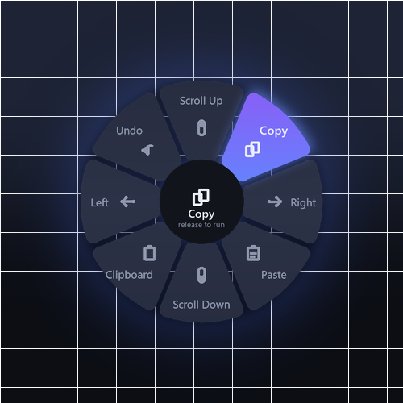
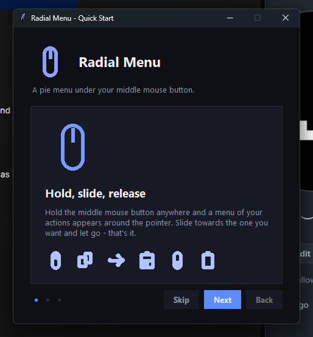
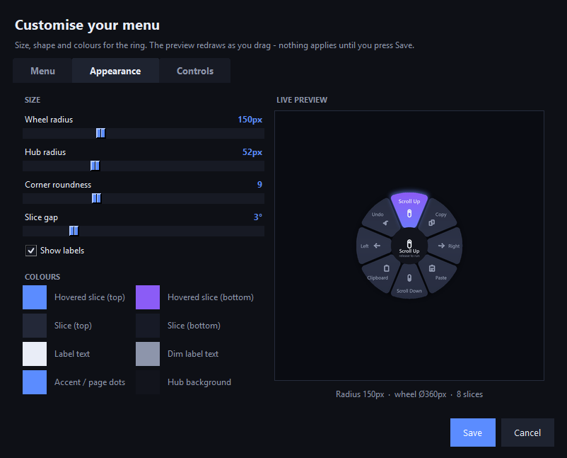
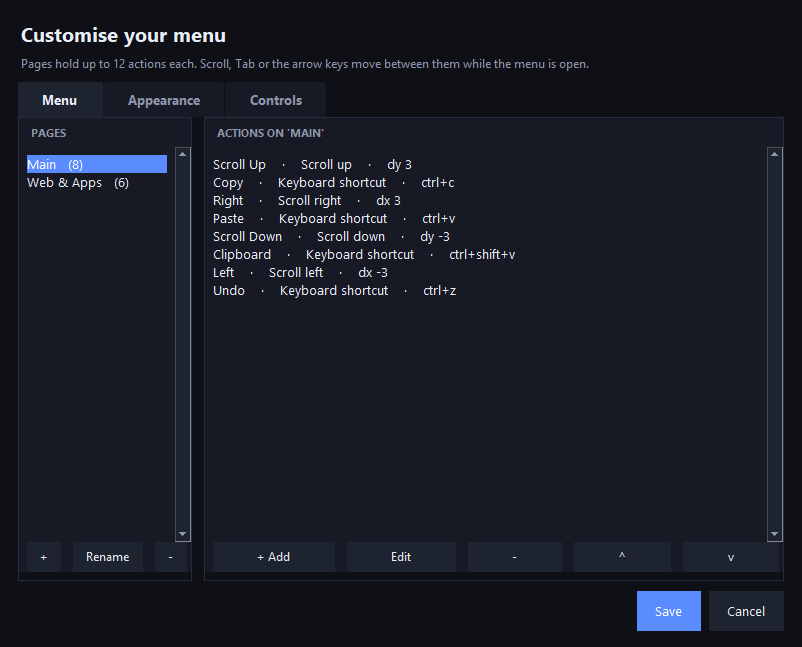

# Radial Menu

**A pie menu that lives under your middle mouse button.** Hold, slide, release —
eight actions appear around your pointer, so the one you want is always one
flick away instead of buried in a toolbar.



---

## Why

Menus are far apart and slow to reach. A radial menu puts every option at the
same distance from where your cursor already *is*, which makes it fast enough
to use without looking. This one is a true **overlay** — per-pixel alpha, soft
shadows, click-through, and it never steals focus — so it sits on top of
whatever you are doing without interrupting it.

---

## Quick start

```bash
pip install -r requirements.txt
python radial.py        # or pythonw radial.py to run without a console
```

Build a standalone exe:

```bash
pip install pyinstaller
pyinstaller --onefile --noconsole --name RadialMenu --add-data "config.json;." radial.py
```

The build lands in `dist/RadialMenu.exe`. On first run it copies `config.json`
next to itself so you can edit it without rebuilding.

> `--noconsole` leaves `sys.stderr` as `None` on Windows, so nothing can print
> a traceback. Errors go to **`radial_menu.log`** instead — check there first
> if something misbehaves.

---

## How to use it

| Gesture | Result |
|---|---|
| **Hold** the middle button | The wheel opens around the pointer |
| **Slide** toward a slice | That slice lights up; the hub names it |
| **Release** on a slice | The action runs |
| **Release** at the centre | Cancels — nothing happens |
| **Scroll** while held | Turn pages — the hub dots show which page you're on |
| **→** (or **Tab** / **PageDown**) | Next page |
| **←** (or **PageUp**) | Previous page |
| **Esc** while held | Cancels |
| **1–9** or **Numpad** | Jump straight to that slice (within the current page) |

Arrow keys are the default because they are under your thumb without moving
your hand. Tab / PageDown / PageUp stay bound as fallbacks even after you
rebind the arrows — **Controls tab → *Turn pages with*** changes the primary
key without ever taking paging away.

The wheel enters with a short scale-and-fade and closes instantly on release:
animating *out* would just delay the action you asked for.

### The tray icon

A background app should never be a mystery process. The tray icon shows that
the menu is running and gives you an exit that isn't Task Manager:

- **Double-click** — reopen the tutorial
- **Right-click** → ***Customise menu...***, *Show tutorial*,
  *Menu enabled* (toggle), *Quit*

### First-run tutorial

New users get a three-step onboarding window on first launch: the gesture
explained, what each part of the wheel does, and a practice round. It is
skipped on every later launch — **Right-click the tray icon → *Show tutorial***
brings it back.



---

## Configuration

Everything lives in `config.json`:

```json
{
  "radial": {
    "enabled": true,
    "trigger_button": "middle",
    "bindings": { "next_page": ["right"], "prev_page": ["left"] },
    "radius": 150,
    "inner_radius": 52,
    "corner_radius": 9,
    "gap_degrees": 3.0,
    "show_labels": true
  }
}
```

| Key | Meaning |
|---|---|
| `trigger_button` | `middle`, `left`, `right`, or `x1` / `x2` (side buttons) |
| `bindings` | Which keys turn pages; `next_page` / `prev_page` each take a list |
| `radius` | Outer radius in px |
| `inner_radius` | Radius of the empty hub — keep it above your release tolerance |
| `corner_radius` | How round the slice corners are |
| `gap_degrees` | Space between slices; larger = easier to hit cleanly |
| `show_labels` | Labels shrink to fit their slice, so this is safe with many actions |

`bindings` defaults to `right` / `left` and is **only ever read for the
primary key** — `tab`, `page_down` and `page_up` are unioned in as always-on
fallbacks, so a rebind cannot lock you out of paging. A name that does not
resolve to a real key is dropped rather than raising: a typo would otherwise
kill the keyboard listener thread and take every shortcut with it. If you name
the same key for both directions, **next wins**.

### The settings window (start here)

Right-click the tray icon → **Customise menu...** opens a three-tab editor, so
nothing here requires touching JSON.

**Menu** — what the wheel *does*:

- **Pages** (left) — add, rename, or delete pages; double-click to rename
- **Actions** (right) — add, edit, delete, and reorder with `^` / `v`
- Each action has a **label**, a **what it does** type (App, Website, Keyboard
  shortcut, Run a command, Type text, or Scroll up/down/left/right), a
  **target** — with *Browse...* for programs — and an optional **icon** from
  the set below

**Appearance** — how the wheel *looks*, with a live preview that redraws as
you drag:

- Sliders for **wheel radius**, **hub size**, **corner roundness** and **gap**
- **Show labels** toggle
- Eight **colour swatches** (both slice gradients, both hover gradients, label
  text, dim text, accent, hub) — click one for the colour picker
- The preview caption tracks the resulting size, e.g. *`Radius 150px · wheel
  Ø360px · 8 slices`*



**Controls** — what the *interface* responds to:

- **Open menu with** — the trigger button
- **Turn pages with** — the next-page and previous-page keys
- Nothing applies until **Save**, and the hint panel spells out that the ring
  always opens centred on the pointer

**Save** applies immediately: the running menu reloads itself, no restart
needed. Every other key in `config.json` is preserved as-is.



### Pages

Actions are grouped into pages, so the wheel can hold far more than 12
entries. Each page is a complete wheel of its own — up to 12 slices — and the
dots along the bottom of the hub show which page you are on (filled = current).

```json
"radial": {
  "pages": [
    { "name": "Main",       "actions": [ ... ] },
    { "name": "Web & Apps", "actions": [ ... ] }
  ]
}
```

Older configs with a single flat `actions` array still load untouched: they
become one page named `Main`.

### Actions

`actions` is an array of **up to 12** entries per page. Index 0 sits at the top
(north) and the rest run **clockwise** in 45° steps.

```json
{ "label": "Copy", "type": "hotkey", "target": "ctrl+c" }
```

| `type` | `target` | Runs |
|---|---|---|
| `hotkey` / `key` | `"ctrl+shift+v"` | Presses that key combo |
| `app` | `"notepad.exe"` | Launches the program |
| `url` | `"https://github.com"` | Opens in your browser |
| `command` | `"python {dir}/script.py"` | Runs a shell command (`{dir}` = app folder) |
| `scroll` | `dx`, `dy` instead | Scrolls horizontally / vertically |
| `type` | `"some text"` | Types the string |

### Icons

Give a slice an explicit icon with `"icon"`:

```json
{ "label": "GitHub", "type": "url", "target": "https://github.com", "icon": "globe" }
```

If you omit it, the icon is inferred from the action — a `hotkey` of `ctrl+c`
becomes a copy glyph, `scroll` with `dy > 0` becomes scroll-up, a URL becomes a
globe, and so on. Available names:

```
arrow_up   arrow_down  arrow_left  arrow_right   scroll_up  scroll_down
copy       paste       undo        redo          clipboard  check
folder     globe       terminal    camera        search     settings
star       lock        unlock      power         play       music
mic        chat        mail        home          trash      plus
close      dots        mouse
```

### Theme

`radial.theme` is a colour dictionary — every key is optional and falls back to
the default. The **Appearance tab** edits the eight you are most likely to want
with colour swatches and a live preview; this table covers the same keys for
hand-editing:

| Key | Controls |
|---|---|
| `slice_top` / `slice_bottom` | Gradient of an idle slice |
| `hover_top` / `hover_bottom` | Gradient of the slice under your pointer |
| `glow` | The halo around the hovered slice |
| `hub` / `hub_border` | Centre readout panel |
| `text` / `text_dim` | Labels, and the hub's hint line |
| `accent` | Highlight used across the UI |

---

## How it works

| File | Role |
|---|---|
| `radial.py` | Control loop, input listeners, animation, wiring |
| `render.py` | Pure-PIL renderer: wedges, icons, labels, hub, page dots |
| `overlay.py` | Win32 layered window (`UpdateLayeredWindow`, premultiplied BGRA) |
| `settings.py` | Three-tab customiser: pages, appearance + preview, controls |
| `tutorial.py` | First-run onboarding |
| `tray.py` | System tray icon and menu |
| `actions.py` | Config loading and action execution |

A few decisions worth knowing about:

- **The overlay is a real Win32 layered window**, not Tk's `-transparentcolor`
  trick. That gives genuine per-pixel alpha — antialiased edges with no colour
  fringe where the wheel meets the desktop.
- **The renderer supersamples at 2×** and builds each wedge from a densely
  sampled polygon that is then Minkowski-dilated (thick lines plus discs),
  which is what gives the slices their rounded corners.
- **Everything is drawn off-thread.** Tk owns the message loop on the main
  thread; the wheel is rendered and blitted by a background loop. Tk is not
  thread-safe, so it is never touched from that worker.
- **The control loop cannot die.** Each queued event and each frame is guarded
  individually, because a single unhandled exception there would otherwise
  leave a menu that silently stops responding.

---

## Troubleshooting

**The wheel doesn't appear.** Check `radial_menu.log` next to the exe (or
`%TEMP%` if the folder isn't writable). Also confirm `radial.enabled` is
`true` and you haven't toggled it off via **tray → Menu enabled**.

**Nothing logs at all.** The app isn't running — check the tray overflow area
(the `^` arrow) for the wheel icon.

**Keys fire in the wrong application.** Actions use synthetic input, so they go
to whatever window has focus *when you release*. Release inside the app you
meant to affect.

**Reset the tutorial.** Set `"tutorial": { "seen": false }` in `config.json`,
or use the tray menu.

---

## License

Use it, modify it, ship it — no attribution required.
